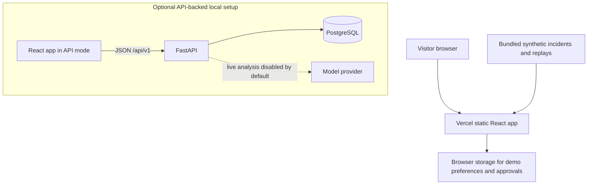

# Incident Atlas

## 1. Project title and description

Incident Atlas is an incident investigation demo for exploring synthetic service incidents. It brings timelines, service dependencies, metrics, logs, traces, saved investigation replays, and evidence references into one reviewable workflow. A visitor can record a simulated mitigation approval; the demo never changes an external system.

## 2. Live deployment link

[Open the Incident Atlas demo](https://incident-atlas-demo.vercel.app/)

The public site is a static frontend using bundled synthetic fixtures. It does not connect to the FastAPI service or PostgreSQL. Approvals are stored in the current browser; live analysis and server persistence are unavailable.

## 3. Project overview and objectives

Incident response often means piecing together a timeline from service maps, metrics, logs, traces, and deployment events. Incident Atlas demonstrates how those signals can be gathered around a single incident and presented with traceable evidence.

Project objectives:

- Make a synthetic incident journey easy to inspect without an account or provider key.
- Keep saved reports and their evidence references reviewable.
- Label hypotheses and uncertainty clearly instead of presenting a cause as fact.
- Keep approvals simulation-only, with no remediation executor or external side effects.

All incident data is authored synthetic data shaped like OpenTelemetry records. It is not customer telemetry or a set of real production incidents.

## 4. Key features

- Browse synthetic incidents and inspect each incident's timeline and service dependencies.
- Explore metrics, logs, and traces for the selected incident.
- Open a stored replay that works without a model call or API key.
- Follow report citations to the evidence items they reference.
- Record a simulated mitigation approval; in the public static demo, it stays in the current browser.
- Use an API-backed FastAPI/PostgreSQL mode locally. Its optional live-analysis route is disabled by default.
- View account and settings screens as frontend previews; they do not provide real authentication or server-side profiles.

## 5. Technology stack

| Area | Technology |
|---|---|
| Frontend | React 19, TypeScript 7, Vite 8, React Router |
| Backend | Python 3.12, FastAPI, Pydantic, SQLAlchemy, Alembic |
| Database | PostgreSQL 17 in the local Compose setup |
| Testing | Node test runner, pytest, Playwright, TypeScript checks |
| Hosting | Vercel for the public static frontend; FastAPI and PostgreSQL are not publicly deployed |
| CI | GitHub Actions |

## 6. System architecture

The public deployment serves a static frontend and bundled fixtures. The repository also supports an API-backed local setup for development.



The public Vercel build uses the static-demo mode and does not make API requests. The local API path serves synthetic fixtures, saved replays, and optional investigation endpoints. If enabled in a separately configured environment, the live-analysis path is server-side and bounded by evidence and request limits.

## 7. Software design diagrams

- **Investigation sequence diagram:** [Architecture and workflow](docs/architecture.md#investigation-workflow)
- **Database entity relationship diagram:** [Data design](docs/data-design.md#relationships)
- **Infrastructure and component diagram:** the current public/local split is shown in [System architecture](#6-system-architecture). The deployment runbook describes the separate, optional API-hosting design in [docs/deployment.md](docs/deployment.md).

## 8. Folder structure

```text
.
├── api/
│   ├── incident_atlas/       # FastAPI routes, services, schemas, and data access
│   ├── migrations/           # Alembic database migrations
│   └── tests/                # Backend tests
├── data/
│   ├── incidents/            # Public synthetic incident fixtures and replays
│   └── evaluation/           # Separate local/CI evaluation data
├── docs/
│   └── docs and project documentation
├── web/
│   ├── src/                  # React application and API/data clients
│   └── tests/                # Frontend and browser smoke checks
├── scripts/                  # Release and deployment utilities
├── .github/workflows/        # CI workflow
├── compose.yaml              # Local PostgreSQL, API, and web services
└── Dockerfile                 # API container image
```

## 9. Installation and setup

For the full local stack, install Docker Engine with the Compose plugin, then run this from the repository root:

```bash
docker compose up --build
```

Open the web app at [http://localhost:5173](http://localhost:5173). The API is at [http://localhost:8000](http://localhost:8000), with interactive docs at [http://localhost:8000/docs](http://localhost:8000/docs). Compose starts PostgreSQL, applies migrations, and seeds runtime fixtures. Stored replays and simulated approvals work with live analysis disabled.

To build the frontend-only demo locally:

```bash
cd web
npm ci
VITE_DATA_MODE=static-demo npm run build
```

For manual API setup and development commands, see [api/README.md](api/README.md) and [web/README.md](web/README.md).

## 10. Environment variables

The checked-in example files document configuration without containing production credentials:
[frontend](web/.env.example), [Vercel static demo](web/.env.vercel.example), and [API](api/.env.example).

| Variable | Used by | Purpose |
|---|---|---|
| `VITE_DATA_MODE` | Frontend build | Use `static-demo` for the public static site or `api` for an API-backed build. |
| `VITE_API_BASE_URL` | Frontend build | API origin ending in `/api/v1` when using API mode. Leave unset for the static demo. |
| `DATABASE_URL` | API | PostgreSQL connection for the API runtime. |
| `MIGRATION_DATABASE_URL` | Deployment/bootstrap | Separate database credential used for migrations and seeding. |
| `RUNTIME_DB_PASSWORD` | Deployment/bootstrap | Password used to verify the restricted runtime database role. |
| `PUBLIC_SITE_ORIGIN`, `CORS_ALLOWED_ORIGINS` | API | Exact HTTPS site origin and matching CORS allowlist. |
| `TRUSTED_PROXY_CIDRS` | API | Verified ingress proxy ranges for forwarded client addresses. |
| `RATE_LIMIT_HMAC_KEY` | API | Secret used for privacy-preserving rate-limit identifiers. |
| `LIVE_ANALYSIS_ENABLED` | API | Defaults to `false`; live analysis remains disabled until deployment checks are complete. |
| `OPENAI_API_KEY`, `OPENAI_MODEL` | API | Optional server-side provider configuration; not needed for the public demo or stored replays. |

Never put `OPENAI_API_KEY`, database credentials, or other server secrets in a `VITE_` variable. Frontend `VITE_` values are included in the browser bundle.

## 11. API documentation

The API base path is `/api/v1`. Full request and response contracts are in [docs/api-design.md](docs/api-design.md); a running local API also exposes [OpenAPI JSON](http://localhost:8000/openapi.json) and [Swagger UI](http://localhost:8000/docs).

| Method | Endpoint | Purpose |
|---|---|---|
| `GET` | `/healthz`, `/readyz` | Liveness and database readiness |
| `GET` | `/api/v1/demo-capabilities` | Report which demo paths are enabled |
| `GET` | `/api/v1/incidents` | List incidents; supports severity/service filters and pagination |
| `GET` | `/api/v1/incidents/{incident_id}` | Read incident details |
| `GET` | `/api/v1/incidents/{incident_id}/timeline` | Read bounded timeline events |
| `GET` | `/api/v1/incidents/{incident_id}/dependencies` | Read the incident service graph |
| `GET` | `/api/v1/incidents/{incident_id}/telemetry` | Read metrics, logs, or traces |
| `GET` | `/api/v1/incidents/{incident_id}/replay`, `/api/v1/replays/{replay_id}` | Read a stored report without a model call |
| `POST` | `/api/v1/investigations` | Request a bounded live investigation; disabled by default |
| `GET` | `/api/v1/investigations/{investigation_id}` | Read a saved live investigation |
| `POST` | `/api/v1/investigations/{investigation_id}/mitigation-approvals`, `/api/v1/replays/{replay_id}/mitigation-approvals` | Record a simulation-only approval |
| `GET` | `/api/v1/investigations/{investigation_id}/mitigation-approvals/{mitigation_id}`, `/api/v1/replays/{replay_id}/mitigation-approvals/{mitigation_id}` | Restore a saved approval for the current anonymous visitor |
| `GET` | `/api/v1/snapshots/{snapshot_id}`, `/api/v1/snapshots/{snapshot_id}/evidence/{evidence_id}` | Read snapshot metadata and resolve cited evidence |

Example local requests:

```bash
curl http://localhost:8000/api/v1/incidents
curl http://localhost:8000/api/v1/incidents/inc-cache-collapse-001/replay
curl http://localhost:8000/api/v1/replays/replay-cache-v1
```

To record a simulation, use the `hypothesis_id` and `mitigation_id` from a replay response:

```bash
curl -X POST http://localhost:8000/api/v1/replays/replay-cache-v1/mitigation-approvals \
  -H 'Content-Type: application/json' \
  -d '{"hypothesis_id":"<hypothesis-id>","mitigation_id":"<mitigation-id>","simulation_acknowledged":true}'
```

## 12. Testing

The CI workflow in [`.github/workflows/ci.yml`](.github/workflows/ci.yml) covers PostgreSQL migrations and backend integration tests, Python lint and dependency auditing, frontend tests/typechecking/build and dependency auditing, API container startup, and desktop/mobile browser flows. The static-demo/Vercel change passed [GitHub Actions PR run #3](https://github.com/mrabishekraj2004-cpu/incident-atlas/actions/runs/45265136934) before it was merged; see [Actions](https://github.com/mrabishekraj2004-cpu/incident-atlas/actions) for the current branch status.

Run the main checks locally:

```bash
cd api
uv run pytest -q -rs
uv run ruff check .
uv audit --locked

cd ../web
npm test
npm run typecheck
VITE_DATA_MODE=static-demo npm run build
npm audit --audit-level=moderate
```

The scenarios and evaluation cases are synthetic regression data; their results do not measure accuracy on real production incidents. No genuine live provider result is part of the public demo.

## 13. Deployment instructions

The public frontend is deployed on Vercel from the `web/` root directory:

1. Set the Vercel Root Directory to `web` and framework preset to **Vite**.
2. Use `npm ci` as the install command, `npm run build` as the build command, and `dist` as the output directory.
3. Set `VITE_DATA_MODE=static-demo` for Production and Preview. Leave `VITE_API_BASE_URL` unset.
4. Enable **Include source files outside of the Root Directory in the Build Step**, because the frontend imports synthetic fixtures from `data/incidents/`.
5. Keep the checked-in Vercel rewrite so direct navigation and refreshes work on app routes.

The deployed site is [incident-atlas-demo.vercel.app](https://incident-atlas-demo.vercel.app/). The FastAPI service and PostgreSQL database are not deployed. [docs/deployment.md](docs/deployment.md) contains the separate backend hosting plan; its backend steps are not part of the current public deployment.

## 14. Challenges and solutions

| Challenge | Engineering decision |
|---|---|
| Present several signal types without losing incident context | Group timelines, dependencies, metrics, logs, and traces around a stable incident ID and bounded time window. |
| Make saved reports inspectable | Preserve evidence references and expose snapshot/evidence lookup routes in the API-backed design. |
| Avoid implying that a replay is fresh analysis | Label stored reports as replays and keep them independent from provider calls. |
| Demonstrate an approval step without affecting operations | Store explicit simulation-only approvals; provide no external remediation executor. |
| Keep a dependable public demo when backend hosting is absent | Ship a static Vercel build with bundled synthetic fixtures and browser-local approvals. |

## 15. Future improvements

- If a hosting budget and account are available, deploy the API and database and connect them to the frontend.
- Replace account/settings preview screens with real authentication and server-side persistence if the product needs user accounts.
- Verify a genuine live provider request and its production limits before enabling live analysis.
- Select and add a project license.

## 16. Author and license

- **Author:** [@mrabishekraj2004-cpu](https://github.com/mrabishekraj2004-cpu)
- **Repository:** [mrabishekraj2004-cpu/incident-atlas](https://github.com/mrabishekraj2004-cpu/incident-atlas)
- **License:** No license has been selected or added. See [docs/licensing-decision.md](docs/licensing-decision.md).
