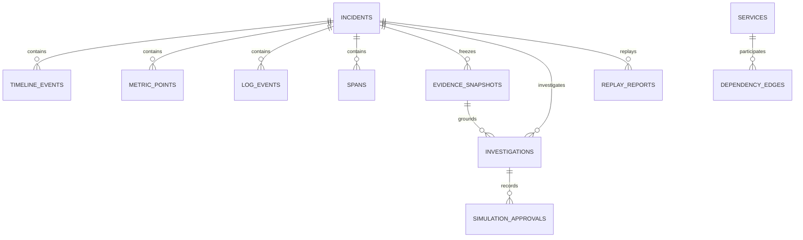
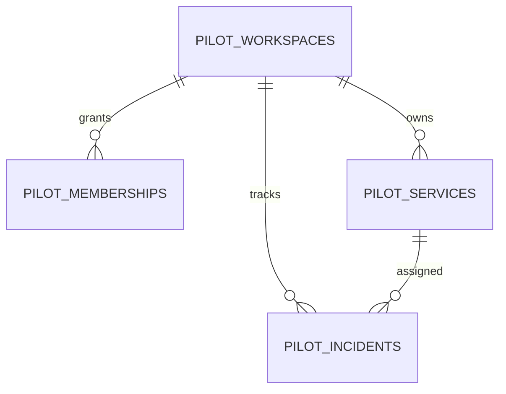
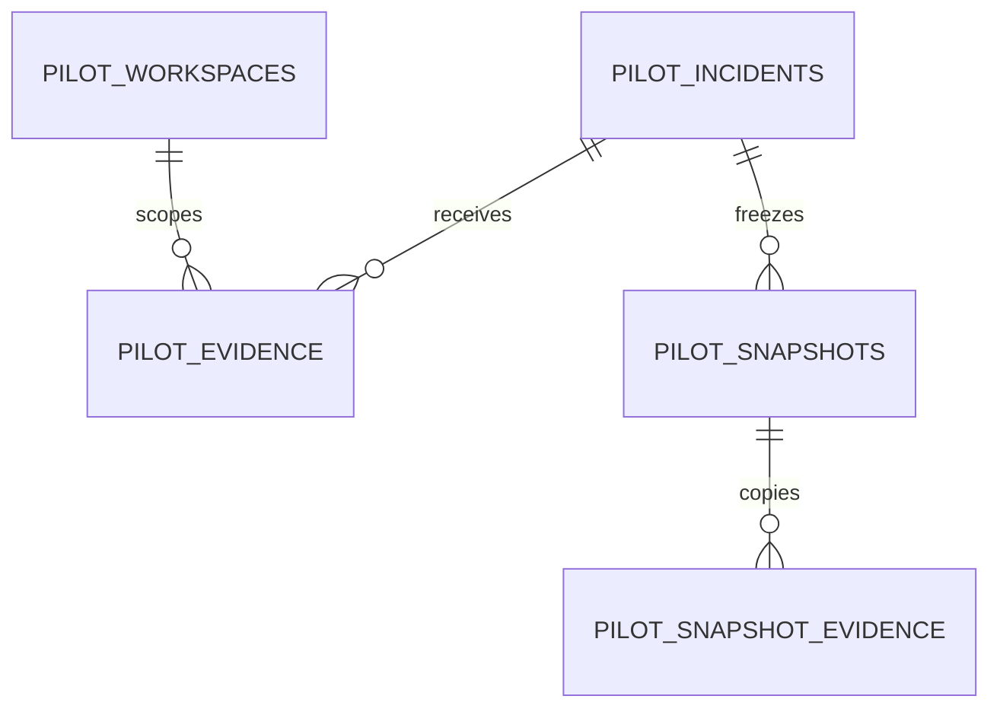
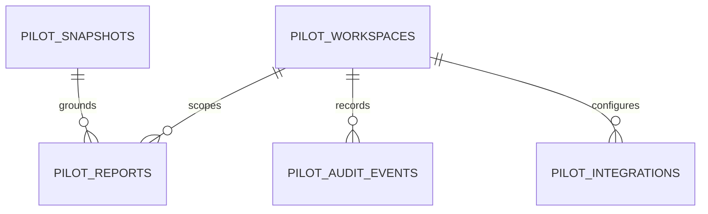

# Data design

**Status:** Existing demo schema plus additive pilot schema  
**Database:** PostgreSQL  
**Reviewed:** 2026-11-27

## Design rules

- Every fixture has a stable ID, explicit version, and deterministic time window.
- Ground-truth labels live in evaluation data, not the runtime evidence query result. Loader and prompt tests must prove that ground truth never enters the live analysis packet.
- Public telemetry fields are synthetic and bounded. Do not add user uploads or production secrets to the first version.
- Telemetry evidence IDs are stable within a fixture version. A live run copies selected source IDs into an immutable evidence snapshot so later fixture edits cannot change what an old hypothesis cited.
- Structured fields are relational columns. `JSONB` is for extensible attributes and validated evidence/report payloads, not opaque storage for all records.
- Store UTC timestamps as `timestamptz`, values with explicit units, and fixed foreign keys between reports and evidence snapshots.

## Logical entities

### `incidents`

`id` text primary key; `slug` unique; `title`; `severity` enum (`SEV-1` to `SEV-4`); `primary_service_id`; `summary`; `started_at`; `ended_at`; `fixture_version`; `scenario_seed`; `display_timezone` default `UTC`; `created_at`.

### `services`

`id` text primary key; `name` unique; `tier`; `team`; `description`; `attributes` JSONB constrained to an object.

### `incident_services`

Join table `incident_id`, `service_id`, `role` (`affected`, `dependency`, `upstream`), composite primary key. Prevent duplicate membership.

### `dependency_edges`

`id`; `incident_id`; `from_service_id`; `to_service_id`; `relationship`; `observed` boolean; `attributes` JSONB. Constraint rejects self-edge and duplicate directed edges for an incident. These edges describe fixture topology, not network discovery.

### `timeline_events`

`id` stable evidence ID; `incident_id`; `occurred_at`; `kind` (`alert`, `deploy`, `metric_anomaly`, `log_marker`, `trace_marker`, `operator_note`); optional `service_id`; `title`; `summary`; `source_record_id`; `fixture_version`; `attributes` JSONB. Index `(incident_id, occurred_at, id)`.

### `metric_points`

`id` stable evidence ID; `incident_id`; `series_id`; `metric_name`; `service_id`; `observed_at`; numeric `value`; `unit`; `statistic` (`gauge`, `counter_delta`, `histogram_p50`, `histogram_p95`, `histogram_p99`); `labels` JSONB; `fixture_version`. Index `(incident_id, metric_name, service_id, observed_at)`.

### `log_events`

`id` stable evidence ID; `incident_id`; `observed_at`; `severity`; `service_id`; `body` (synthetic text); optional `trace_id`, `span_id`; `attributes` JSONB; `fixture_version`. Index `(incident_id, service_id, observed_at)` and a bounded trace lookup index.

### `spans`

`id` stable evidence ID; `incident_id`; `trace_id`; `span_id`; optional `parent_span_id`; `service_id`; `operation`; `started_at`; `duration_ms`; `status`; `attributes` JSONB; `fixture_version`. Unique `(incident_id, trace_id, span_id)`; indexes by incident/time/service and trace/parent.

### `evidence_snapshots`

`evidence_snapshots` stores `id`; `incident_id`; `fixture_version`; `created_at`; `window_start`; `window_end`; `sha256`; `item_count`; and `payload_version`. `snapshot_evidence` stores each immutable evidence ID, kind, source ID, service, UTC observation time, and JSONB payload under `(snapshot_id, evidence_id)`. PostgreSQL triggers reject update and delete operations on both snapshot tables. The hash is calculated over canonical JSON with sorted keys and normalized UTC timestamps.

### `investigations`

`id`; `incident_id`; `status` (`running`, `completed`, `failed`, `timed_out`, `refused`, `invalid_output`); `snapshot_id`; `model_id`; `prompt_version`; `schema_version`; `started_at`; optional `completed_at`; optional `error_code`; input/output token counts; `provider_request_id`; trace ID; keyed idempotency namespace and request fingerprint; explicit uncertainty; and the deterministic rules result. Validated hypotheses are stored in the separate `hypotheses` table. Never persist chain-of-thought or raw provider payloads.

### `hypotheses`

`id`; exactly one of `investigation_id` or `replay_report_id`; rank 1–3; statement; confidence and explanation; supporting/contradicting evidence ID arrays; next read-only check; optional mitigation ID/summary. All cited evidence IDs are checked against that result's `snapshot_id` before the report is returned.

### `replay_reports`

`id`; `incident_id`; `fixture_version`; `created_at`; `snapshot_id`; `report` JSONB; `rules_version`. The replay is immutable, precomputed, and served with `source=stored_replay` and `model_call_made=false`.

### `simulation_approvals`

`id`; nullable `investigation_id`; nullable `replay_report_id`; `hypothesis_id`; `mitigation_id`; `status` fixed to `simulated_approved`; `simulation_only` fixed true; `external_action_performed` fixed false; `recorded_at`; an HMAC-derived `visitor_session_hash`; and `request_id`. A check constraint requires exactly one of `investigation_id` or `replay_report_id`. A unique constraint on the selected result, `mitigation_id`, and visitor hash prevents duplicate submissions from one source while allowing another anonymous visitor to record the same simulation. A database trigger rejects updates and deletes. The row has no downstream action consumer.

### `evaluation.labels`

`case_id`; `incident_id`; `fixture_version`; `expected_primary_label`; `acceptable_secondary_labels`; `expected_supporting_evidence_ids`; `expected_contradicting_evidence_ids`; `expected_abstention` boolean; `label_version`; notes. This table remains in the separate PostgreSQL `evaluation` schema and is loaded only through explicit seed/evaluation commands. The API runtime uses a dedicated least-privilege database role without access to that schema; PostgreSQL CI verifies the denied reads as well as the required runtime grants. The actual Render-managed database role check remains unverified. Runtime routes and the live packet builder do not query or serialize these rows, and the production API image omits the evaluation answer-key files.

### `audit_events` and `guest_rate_events`

`audit_events` records replay access, investigation lifecycle, and simulation approvals without storing raw sensitive input. `guest_rate_events` stores only HMAC-derived source hashes, action, and timestamp for anonymous rate accounting. Expired rate rows are deleted before a rate check. The database cleanup function has a fixed seven-day retention cutoff, matching the maximum supported global live-rate window; the actual request window can be shorter.

`simulation_approvals.visitor_session_hash` stores an HMAC of the browser's random anonymous UUID when `X-Incident-Atlas-Visitor-ID` is present. Separate browser profiles on the same public IP can record separate simulations, and a reload can retrieve only the matching browser's saved record. Callers without the header fall back to the proxy-validated client address. This token is a convenience identity for the public demo, not authentication; rate limits continue to use the trusted client address and are shared by visitors behind the same NAT.

## Additive pilot tables

Migration `0005_authenticated_pilot` adds a separate set of tenant-keyed records without changing the public demo's incident, replay, snapshot, or approval schemas:

- `pilot_workspaces` and `pilot_memberships`: workspace identity and an OIDC subject's `owner`, `editor`, or `viewer` role.
- `pilot_services` and `pilot_incidents`: workspace-owned service catalog, owning team, and exercise incident. Composite workspace foreign keys prevent pointing an incident at another workspace's service.
- `pilot_integrations`: one GitHub repository/incident mapping per workspace, protected by the configured webhook-signing secret.
- `pilot_ingest_tokens`: workspace/service-scoped token hash, expiry, and revocation timestamp. Raw tokens are returned only by a local bootstrap/provisioning operation.
- `pilot_evidence`: normalized metric/log/trace/deploy record, event time, receive time, source, redacted payload, and expiry. Tenant-derived IDs and a workspace/source/source-record unique constraint prevent cross-workspace ID collisions and duplicate events.
- `pilot_ingest_batches`: idempotency key, body hash, and accepted/duplicate/rejected counts for retry handling.
- `pilot_snapshots` and `pilot_snapshot_evidence`: immutable evidence copy and canonical SHA-256 hash captured for an investigation. Tenant and composite keys constrain snapshot/incident/report relationships.
- `pilot_reports`: rules-baseline output and timing tied to the snapshot, with expiry.
- `pilot_audit_events`: actor, action, request ID, entity, and bounded attributes; records membership, ownership, reset, and investigation changes.

The API does not rely on PostgreSQL row-level security. It applies workspace predicates in the query boundary and uses composite tenant foreign keys. PostgreSQL integration tests are the release gate for isolation, citation stability, and permission changes. The pilot role grants must include membership maintenance, integration registration, and service-owner updates while retaining least privilege.

## Relationships

The pilot uses separate workspace-keyed tables and composite tenant references:

## Data lifecycle

1. Versioned source fixtures are loaded by an idempotent seed command with `fixture_version` and `scenario_seed`.
2. UI read routes query allowlisted incident and telemetry tables using incident ID plus bounded time/service filters.
3. Live route serializes selected rows to canonical JSON and stores the snapshot/hash before inference.
4. The validated output references only evidence IDs in that snapshot and is persisted as a live investigation.
5. Replay reports are loaded as precomputed fixture records tied to an immutable evidence snapshot.
6. Simulation approval appends an audit row; no service mutation is scheduled or dispatched.

For the pilot, a workspace-scoped service token receives a bounded OTLP batch and stores normalized evidence. A rules-baseline investigation copies active records into `pilot_snapshot_evidence`, persists the snapshot hash and report, and returns citation IDs that resolve through the same workspace/snapshot key. The pilot path does not call an AI provider or write to production services.

## Retention and privacy

Public fixtures and stored demo replays remain versioned project data. Pilot evidence, snapshots, and reports expire after the configured 7–365 days (30-day default); reads hide expired records and `incident_atlas.pilot_cli prune` performs deletion. Audit entries are shown and retained for 365 days. Ingestion batches and stale tokens are pruned after 30 and 365 days respectively. Raw IPs are not stored by the pilot. Attribute names and text matching common secrets, emails, and card-like values are redacted before storage, but only controlled synthetic records are approved for exercise. Backups and restorations must be exercised before hosted staging.
