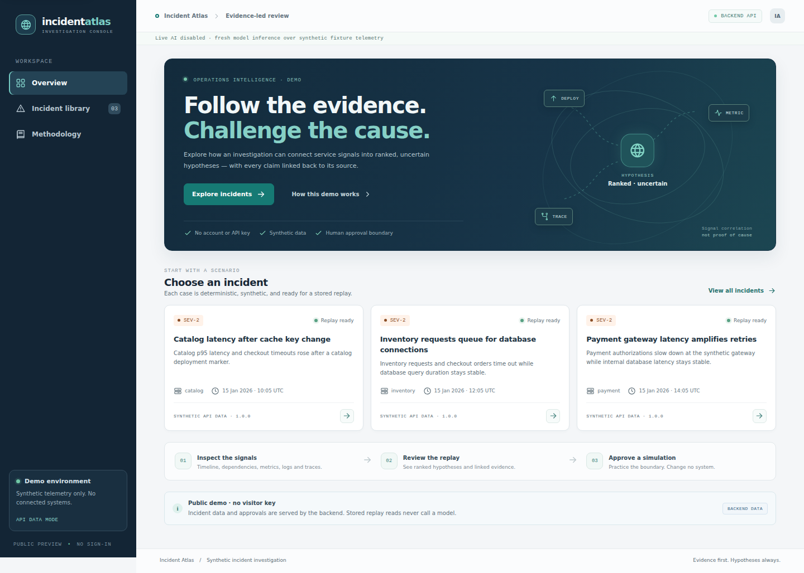
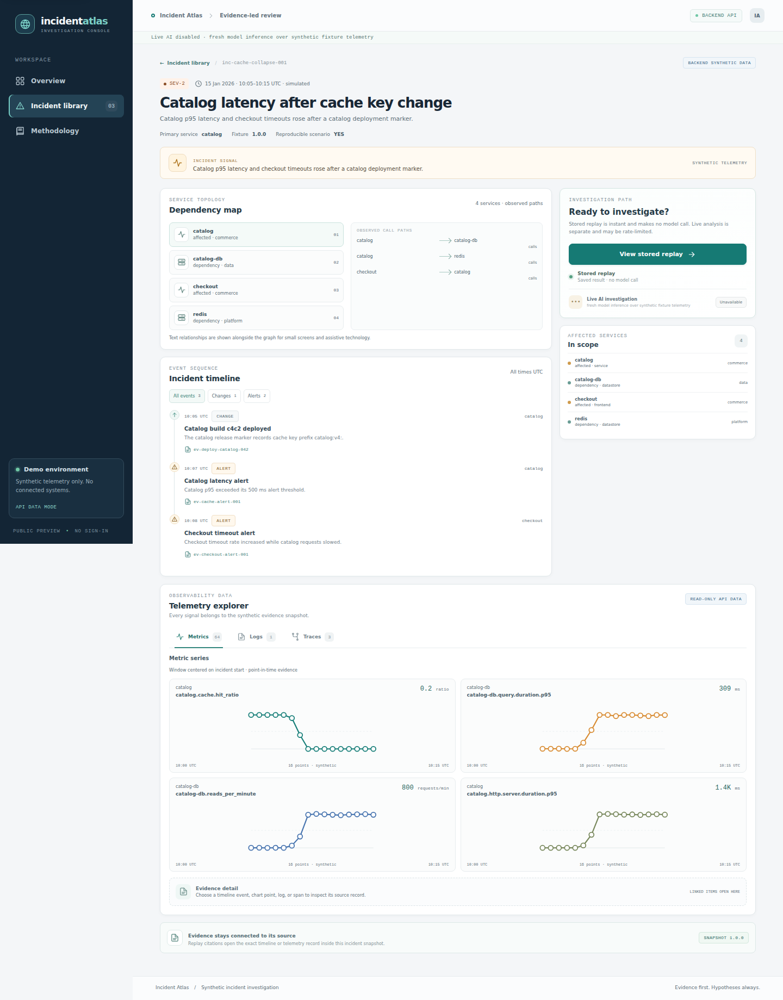
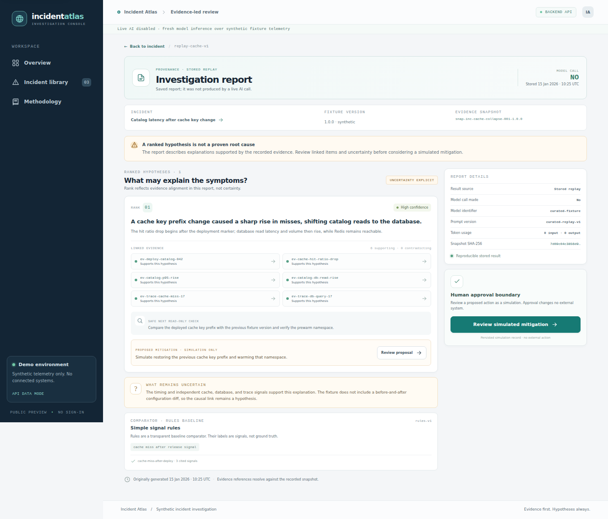
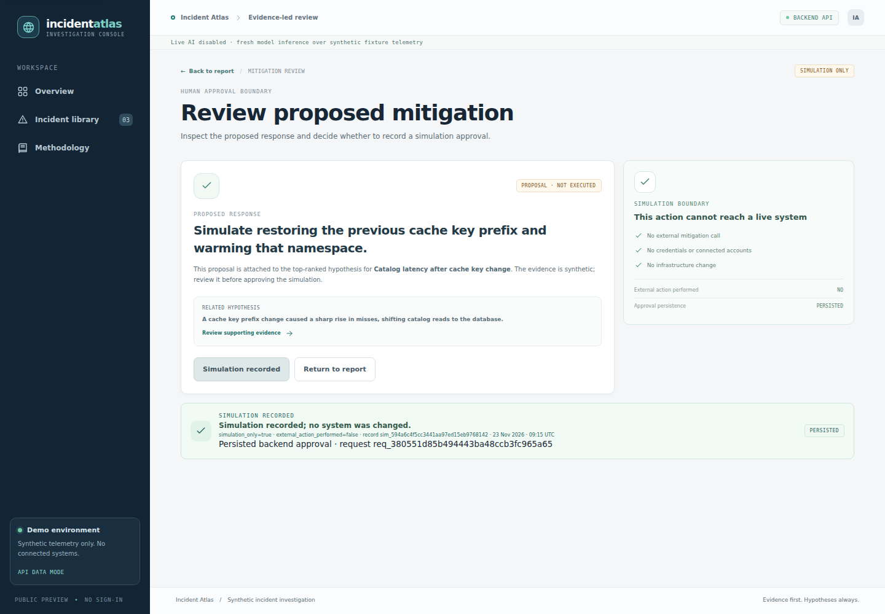
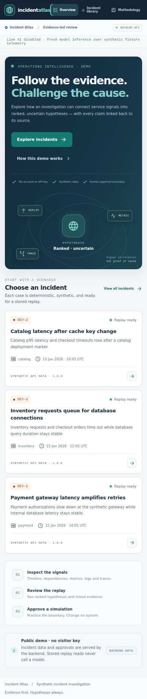

# Incident Atlas — portfolio case study

**Live frontend demo:** [incident-atlas-demo.vercel.app](https://incident-atlas-demo.vercel.app/)  
**Source:** [mrabishekraj2004-cpu/incident-atlas](https://github.com/mrabishekraj2004-cpu/incident-atlas)

## Make incident reasoning reviewable

Incident Atlas is a no-sign-in incident investigation demo. Visitors can choose a synthetic incident, inspect its timeline, dependency map and telemetry, open a stored report, trace each citation to a snapshot record, and review a simulated mitigation. Stored replays do not call a model. Root causes remain hypotheses, and approving a simulation changes no external system.

The live Vercel website is a frontend-only static showcase. It bundles the authored synthetic scenarios and replay reports, needs no visitor API key, and does not call FastAPI or PostgreSQL. Its approval result is saved only in the current browser. The backend source and its PostgreSQL workflow remain in the GitHub repository but are not publicly deployed.

## Product and architecture

The web UI uses React, Vite, TypeScript, and CSS. A typed API client supports the separate FastAPI/PostgreSQL integration path, while the explicit production static-demo mode reads bundled synthetic fixture data. Failed API requests do not silently fall back to fixtures. Vercel builds only `web/`, with the SPA rewrite supporting direct React Router navigation and refreshes.

The backend source includes typed FastAPI contracts, PostgreSQL persistence and migrations, immutable evidence snapshots, stored reports, approval records, audit events, bounded read-only investigation tools, and an optional server-side model path. The model path remains disabled in this public release. No database or model credentials are embedded in the frontend.

## Live preview walkthrough

On 2026-11-23, the public desktop site was opened and the catalog incident detail, timeline, service dependency map, telemetry tabs, stored replay, its six citations, and simulated mitigation flow were checked. Each citation opened its matching timeline, metric, or trace record. The approval required an explicit acknowledgment, showed `simulation_only=true` and `external_action_performed=false`, and remained visible after a refresh in the same browser.

These approvals are not backend-persisted or shared across visitors. A deployed-site mobile-width walkthrough has not been performed. Live AI, backend integration, and real OpenTelemetry Demo data are not part of the live static showcase.

## Evaluation and limitations

The incident evidence is authored deterministic synthetic data shaped like OpenTelemetry records. It is not an import from OpenTelemetry Demo or real production telemetry. The offline rules regression dataset contains 12 authored synthetic cases: three base cases, six derived variants, and three independent authored cases, including expected-abstention cases. Dataset SHA-256:

```
65f6949e8c0c0d2f258fd65c2760591b2ff7b38fbb1edeb38cc3dc16cbac1527
```

GitHub Actions run #3 measured 1.0000 labeled top-1, mean reciprocal rank, expected-support evidence recall, abstention accuracy, and overall decision accuracy on this fixed synthetic set. These figures are regression checks, not real-world incident accuracy. The earlier 0.5222 support-recall result is historical. A separate OTLP/JSON adapter has parser coverage, but no OpenTelemetry Demo capture has been imported or scored. No genuine live-model result has been verified; provider coverage is mocked.

The application code is at commit [76392ba](https://github.com/mrabishekraj2004-cpu/incident-atlas/commit/76392ba2539781f3b49babb84b80aee94cec5043). GitHub Actions [PR #1 run #3](https://github.com/mrabishekraj2004-cpu/incident-atlas/actions/runs/45265136934) passed all five jobs: PostgreSQL-backed backend checks, 16 frontend tests and typecheck, API and static-demo builds, dependency audits, API container runtime checks, browser journey, and release archive validation. The browser job uses local CI services, not the public deployment. See the [deployment and release report](predeployment-release-report.md) for the exact deployment scope and open gates.

## Browser screenshots

These screenshots were captured by the local CI browser workflow against local Vite, FastAPI, and PostgreSQL services seeded with synthetic scenarios. They show local CI behavior only; they are not screenshots of the public Vercel deployment. The artifact is retained with the linked GitHub Actions run.



_Desktop dashboard — local CI app, synthetic fixture catalogue._



_Incident detail — local CI API data, with metrics, logs, and traces available for inspection._



_Stored replay — local CI API response, explicitly labeled as a replay rather than live AI._



_Approval — local CI API response persisted with simulation-only fields._



_Mobile dashboard — 390 px viewport in the local CI browser run._

## Remaining release gates

- FastAPI and PostgreSQL have not been deployed; managed Render database permissions remain unverified.
- Live AI is disabled until a server-side model key, deployed proxy trust, global usage cap, and genuine provider request have been verified.
- No public-site mobile visual check or real OpenTelemetry Demo evaluation has been completed.
- No CV or LinkedIn profile entry was changed from this workflow. The public demo link at the top is ready to add.
- No license file has been added; see the [owner decision note](licensing-decision.md).
